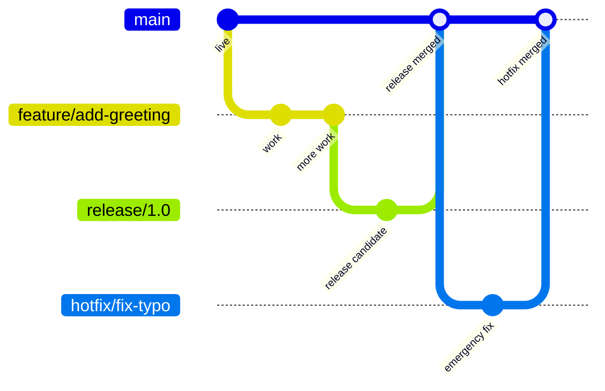
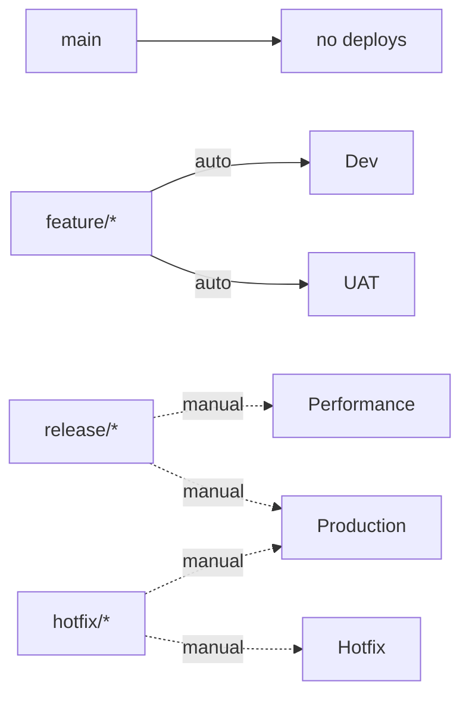
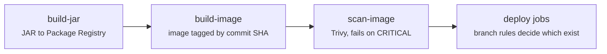
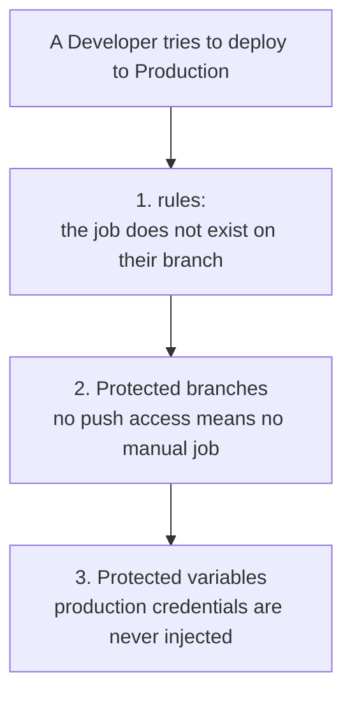

# GitLab Full Automation

A self-managed GitLab CI/CD pipeline implementing an enterprise branching model: five environments, branch-scoped deployment access, Maintainer-only production gates, and automated container scanning.

Everything runs locally. GitLab, the runner, both registries and the Kubernetes cluster are all on one laptop.

---

## What this solves

A company has one codebase and five places it can run. Some of those places are safe to break. One has real users attached.

Without a system, the difference between them is **human discipline**: remembering not to deploy on a Friday, asking permission, being careful. Discipline fails.

This project replaces discipline with **mechanism**. The pipeline makes it impossible to deploy the wrong artefact to the wrong environment, or for the wrong person to trigger it. Nobody has to remember.

---

## The branching model



- **`main`** mirrors what is live in production. It deploys to nothing; code arrives here *after* release, not before.
- **`feature/*`** is cut from `main`. Dev and UAT deploy automatically.
- **`release/*`** is cut from the feature branch once UAT passes. Performance and Production become available, both manual.
- **`hotfix/*`** is cut from `main`, because `main` is what's live. It gets a production-like environment, then goes straight to Production.

Everything merges back into `main` after production, so fixes are never lost in the next release.

---

## Which branch reaches which environment



Solid arrows are automatic. Dashed arrows are manual jobs restricted to Maintainers.

Production has two routes into it: the planned one through a release branch, and the emergency one through a hotfix. The Hotfix environment mirrors Production's configuration and replica count, because it is the only safety check an emergency fix gets.

---

## The pipeline



One `.gitlab-ci.yml` serves every branch. The branch name is the only input that changes.

| Branch | Jobs created | Environments reached |
|---|---|---|
| `main` | 3 | none |
| `feature/*` | 5 | Dev → UAT, automatic |
| `release/*` | 5 | Performance, Production, manual |
| `hotfix/*` | 5 | Hotfix, Production, manual |

Jobs that don't match a branch aren't disabled or greyed out. They are never created, so there is nothing to click.

### Build once, promote the same artefact

The image is built exactly once, tagged with the commit SHA, and pushed to the Container Registry. Every environment pulls that same tag.

Rebuilding per environment would mean shipping something to production that nobody tested, since a dependency or base layer could resolve differently. Tagging by SHA means any running container can be traced back to the exact commit inside it.

---

## Governance

Three independent layers. Defeating one is not enough.



**`rules:`** controls which jobs exist in a pipeline, based on the branch name.

**Protected branches** control who can push to `release/*` and `hotfix/*`. GitLab extends this to manual jobs: running one requires push access to that branch, so a Developer can see the Production button and cannot press it. Wildcard patterns mean branches are protected from the moment they are created, not after someone remembers to configure them.

**Protected CI variables** control which jobs receive credentials. `KUBE_CONFIG_PROD` is only injected into pipelines on protected branches. This was verified by pointing a feature-branch job at it: the variable resolved to an empty string and the deploy failed.

The three live in different places — the pipeline file, repository settings, and CI/CD settings — which is deliberate. A single misconfiguration doesn't open the door.

---

## Security scanning

Trivy scans the built image for vulnerabilities in both OS packages and Java dependencies, on every branch, before any deployment.

The job runs two passes:

```yaml
- trivy image --exit-code 0 --severity HIGH,MEDIUM,LOW ...   # report everything
- trivy image --exit-code 1 --severity CRITICAL ...          # block on criticals
```

Reporting everything while failing only on criticals keeps the gate credible. A scanner that fails on every finding gets ignored within a week.

### What the scan actually found

The first run reported **8 criticals**, including `CVE-2025-24813`, a remote code execution in Tomcat. Upgrading Spring Boot from 3.2.5 to 3.4.5 fixed that one.

The remaining criticals require Tomcat 10.1.55 and Spring Framework 7.0.9, versions no Spring Boot release currently ships. They are suppressed in [`.trivyignore`](.trivyignore), each with a stated reason and a review date.

This is the realistic outcome. The CVE database updates daily and frameworks release monthly, so a dependency tree is never at zero. The gate's job is to catch what is *newly* exploitable and fixable, not to demand an impossible number.

---

## Stack

| Layer | Tool |
|---|---|
| SCM + CI/CD | GitLab CE (self-managed, Docker) |
| Runner | GitLab Runner, Docker executor |
| Build | Maven, Java 17, Spring Boot |
| Artefact storage | GitLab Package Registry (JAR), Container Registry (image) |
| Image | Multi-stage Dockerfile, `eclipse-temurin:17-jre-alpine` |
| Scanning | Trivy |
| Deployment | Helm |
| Runtime | Kubernetes (kind), five namespaces |

---

## Repository layout

```
.gitlab-ci.yml          pipeline: stages, rules, manual gates
.trivyignore            suppressed CVEs, with reasons and review date
Dockerfile              multi-stage build
pom.xml                 Maven build, Package Registry target
ci_settings.xml         Maven auth via CI_JOB_TOKEN
helm/
  Chart.yaml
  values.yaml           chart defaults
  values/               one values file per environment
  templates/            Deployment and Service
src/main/java/          Spring Boot app, reports its environment and version
```

---

## Design decisions

**Push-based deployment rather than GitOps.** Helm runs from CI with cluster credentials, instead of a controller reconciling from Git. GitOps is generally the better pattern, but this project's requirement is a Maintainer-only approval gate, and a pull-based controller syncs the moment the commit lands. Keeping the gate and the permission model in the same system was worth the trade.

**Multi-stage Dockerfile rather than passing the JAR as an artifact.** The Dockerfile stays self-contained and buildable anywhere. The cost is that the JAR is built twice: once for the Package Registry, once inside the image.

**Trivy rather than GitLab's built-in container scanning**, which is an Ultimate-tier feature. Everything here runs on GitLab Community Edition with no licence.

---

## What is simulated

Worth being explicit about, because it is the difference between demonstrating a pattern and running it.

- **Five namespaces on one cluster**, not five clusters. The isolation is logical, not physical.
- **Both kubeconfig variables hold the same credentials.** The separation between `KUBE_CONFIG` and `KUBE_CONFIG_PROD` is enforced at the GitLab layer, so a feature branch genuinely cannot obtain the protected one. At the cluster layer they grant identical access.
- **`insecure-skip-tls-verify` is enabled**, because the local cluster's certificate is issued for `127.0.0.1` while CI connects via `host.docker.internal`. Acceptable on a laptop, never in production.
- **Performance testing is replica count only.** Three replicas, no load generator.

---

## Running it locally

Requires Docker, a Kubernetes cluster (kind or Docker Desktop), Helm and kubectl.

```bash
# 1. GitLab
cd infra/gitlab && docker compose up -d        # wait for (healthy)

# 2. Runner, registered against the GitLab instance
cd ../gitlab-runner && docker compose up -d

# 3. Namespaces
kubectl create namespace dev
kubectl create namespace uat
kubectl create namespace perf
kubectl create namespace prod
kubectl create namespace hotfix
```

Then in GitLab:

- Enable the Container Registry via `registry_external_url`
- Add `KUBE_CONFIG` (File, unprotected) and `KUBE_CONFIG_PROD` (File, protected)
- Protect `main`, `release/*` and `hotfix/*` for Maintainers

---

## Notes from building this

> Rewrite this section in your own words before publishing — it is the part people actually read.

**A missing CI variable is silently empty, not an error.** Pointing a job at a protected variable it cannot receive produced `Kubernetes cluster unreachable`, which looks like a network fault. The cluster was fine. The shell expanded `$KUBE_CONFIG_PROD` to nothing, Helm fell back to its built-in default of `localhost:8080`, and the connection was refused.

**Errors report where parsing stopped, not where the mistake was.** A typo in `docker build` produced a complaint about the `-t` flag, which was correct. A registry `403` was reported alongside "you may be having network problems", when in fact the request had arrived and been refused on authorization.

**`git add` takes a snapshot.** Staging a file mid-conflict and resolving it afterwards commits the broken version. Git reported "all conflicts fixed" because the file was staged, not because it made sense. The pipeline then failed with Java compile errors at exactly the conflict-marker line numbers.

**Tool images override the entrypoint.** `alpine/helm` and `aquasec/trivy` both run their binary as the entrypoint, so GitLab's `sh -c` arrives as an argument and the job fails with `unknown command "sh"`. Fixed with `entrypoint: [""]`.

**`localhost` inside a container means the container.** This came up three times: registering the runner, connecting CI to the cluster, and reaching the registry. `host.docker.internal` is the way out.

**Relative cache paths don't work.** `TRIVY_CACHE_DIR: .trivycache/` resolved somewhere GitLab wasn't caching, so Trivy re-downloaded a 500 MB database every run and occasionally timed out. `$CI_PROJECT_DIR/.trivycache` fixed it.

---

## Roadmap

- Mirror base images into the internal registry, removing the Docker Hub dependency
- Replace the hardcoded `1.0.0` version with a pipeline-derived one
- Evaluate a distroless base image to shrink the vulnerability surface
- Add GitLab Secret Detection
